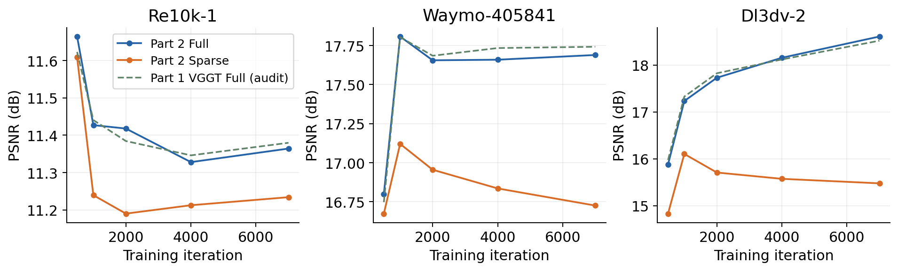
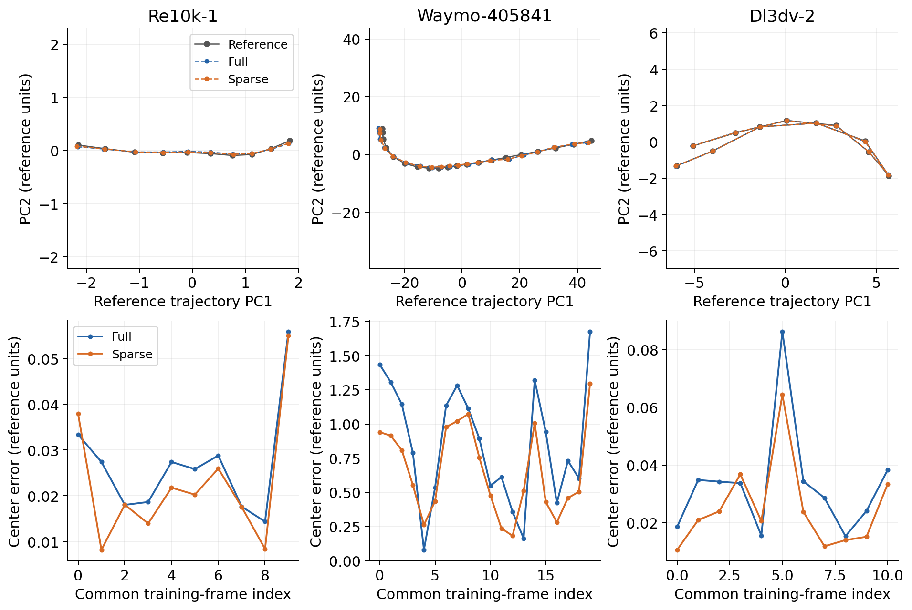
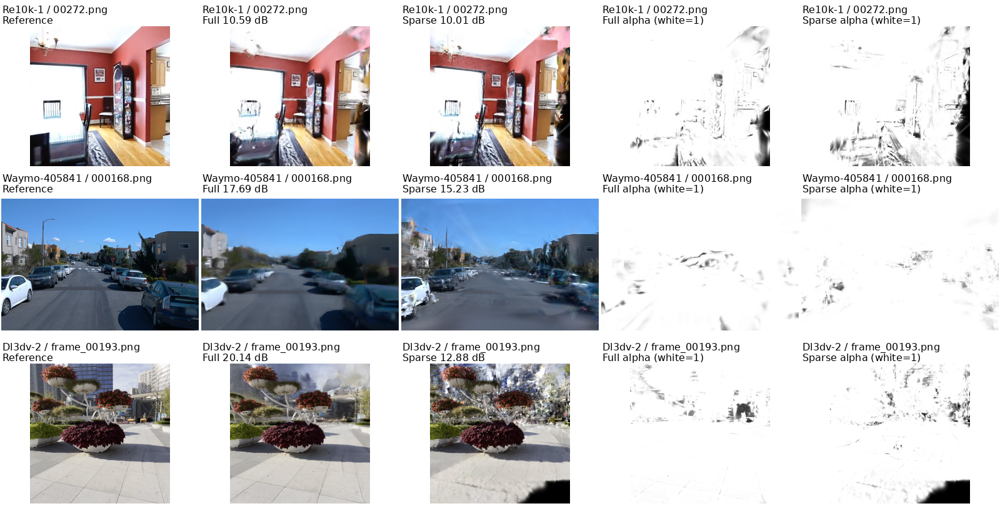
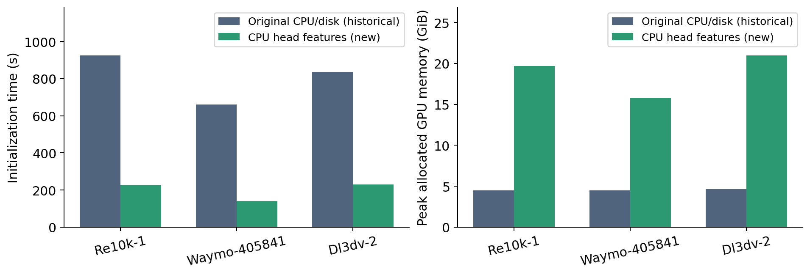
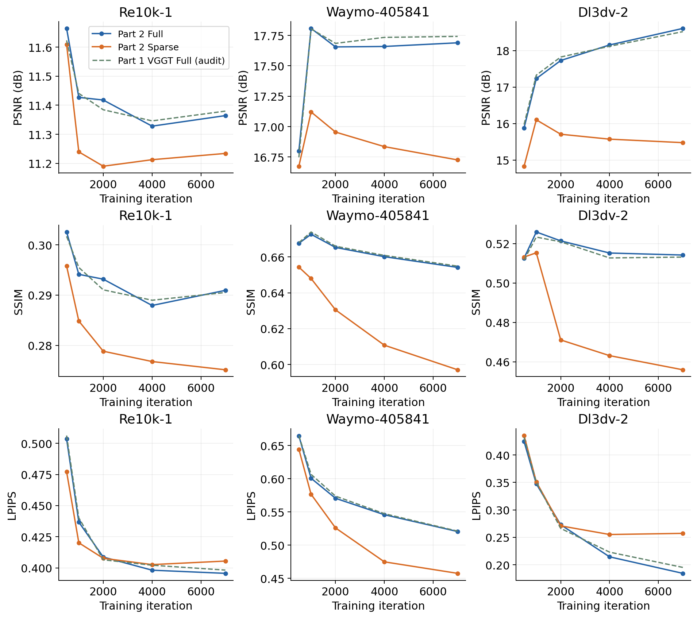
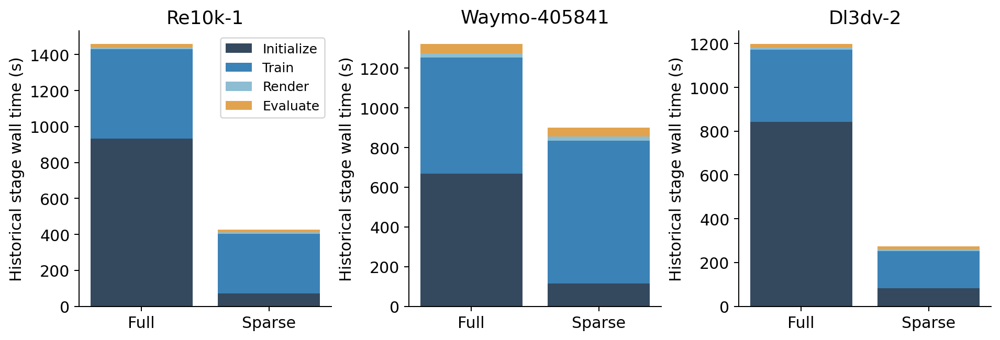
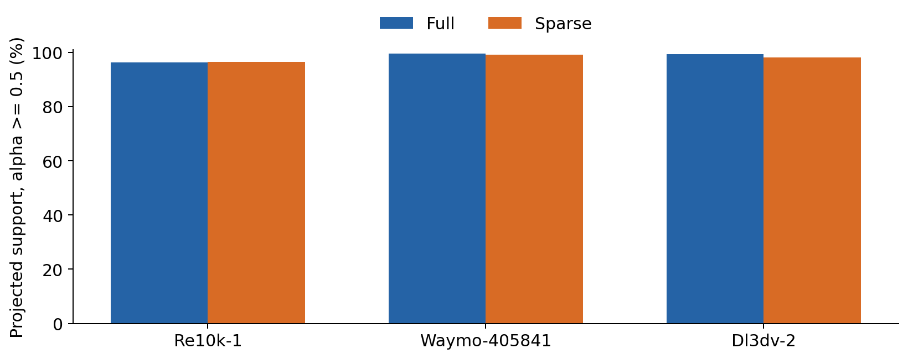

# Part 2 enhanced analysis

All six original 7000-step results are preserved. No new scene training or test-based checkpoint selection was performed.
Custom VGGT-initialized unposed reconstruction: VGGT estimates cameras and geometry only from permitted training RGB; vanilla 3DGS keeps those cameras fixed. This is not an i3dgs reproduction or SLAM.

## Frozen comparison

| Scene | Input | Train / test | PSNR | SSIM | LPIPS | Paired ATE |
| --- | --- | ---: | ---: | ---: | ---: | ---: |
| Re10k-1 | full | 244 / 35 | 11.364 | 0.2910 | 0.3957 | 0.02902 |
| Re10k-1 | sparse | 10 / 35 | 11.234 | 0.2751 | 0.4055 | 0.02643 |
| Waymo-405841 | full | 174 / 25 | 17.689 | 0.6542 | 0.5204 | 0.95649 |
| Waymo-405841 | sparse | 20 / 25 | 16.726 | 0.5971 | 0.4574 | 0.72937 |
| Dl3dv-2 | full | 267 / 39 | 18.609 | 0.5142 | 0.1843 | 0.03790 |
| Dl3dv-2 | sparse | 11 / 39 | 15.479 | 0.4559 | 0.2572 | 0.02903 |

Full has higher PSNR and SSIM in all scenes. Dl3dv has the largest PSNR gain (3.13 dB); Waymo Sparse has lower LPIPS on all 25 test views.
Seed 42, 7000 updates; sparse original positions 1, 1+k, ... use k=10 for Waymo and k=30 otherwise, excluding fixed held-out indices.

A fixed update budget gives different average exposures per image: Re10k Full/Sparse 28.7/700, Waymo 40.2/350, and Dl3dv 26.2/636.4. This fixes update count, not epoch count; image repetition is not isolated as a separate factor.

## Convergence

All 30 condition/iteration points at 500/1000/2000/4000/7000 steps cover 990 per-frame evaluations. Twenty-four intermediate points were evaluated from saved checkpoints; six final points keep the original measurements.
The 7000-step endpoint was fixed before evaluation. Highest sampled test PSNR is diagnostic only and is not used for model selection.

| Scene | Input | Highest sampled PSNR step | Peak minus final |
| --- | --- | ---: | ---: |
| Re10k-1 | full | 500 | 0.300 dB |
| Re10k-1 | sparse | 500 | 0.375 dB |
| Waymo-405841 | full | 1000 | 0.118 dB |
| Waymo-405841 | sparse | 1000 | 0.395 dB |
| Dl3dv-2 | full | 7000 | 0.000 dB |
| Dl3dv-2 | sparse | 1000 | 0.627 dB |

Non-monotonic curves alone do not identify a cause; fixed camera bias, scene coverage and fitting behavior can contribute.

## Cameras and visibility support

Paired ATE and trajectory figures align both conditions on the same sparse TRAIN IDs. The separate all-train ATE matches the support used for rendering alignment and Part 1's reported convention. Units are reference-trajectory units, not assumed meters.
Camera optimization is disabled: ATE is constant during GS training. An ATE-versus-GS-iteration convergence plot would be misleading.
Current Part 1 image hashes, splits and reference cameras match our data. Re10k's roughly 20% focal overestimate also appears in the independent Part 1 VGGT initialization; reference intrinsics are not substituted to repair it.

Alpha coverage measures projected Gaussian support, not true 3D completeness or accuracy. Opaque incorrect geometry can have high coverage.

| Scene | Input | Alpha >= 0.1 | Alpha >= 0.5 | Alpha >= 0.9 |
| --- | --- | ---: | ---: | ---: |
| Re10k-1 | full | 98.98% | 96.39% | 87.27% |
| Re10k-1 | sparse | 98.72% | 96.42% | 83.69% |
| Waymo-405841 | full | 99.92% | 99.50% | 96.35% |
| Waymo-405841 | sparse | 99.73% | 99.10% | 94.18% |
| Dl3dv-2 | full | 99.99% | 99.34% | 95.98% |
| Dl3dv-2 | sparse | 99.23% | 98.12% | 92.29% |

Failure panels select the largest Full-minus-Sparse PSNR gap per scene by a declared rule. All test frames remain in metrics; first/middle/last previews remain in the formal runs.

In these selected views, Re10k shows distorted cabinet/room boundaries in both reconstructions. Waymo Full is smoother around cars and roadside structures, while Sparse retains sharper-looking edges alongside geometric artifacts; this does not isolate the cause of the LPIPS ranking. Dl3dv Sparse shows fragmented foliage and a dark uncovered region at the lower-right ground boundary, whereas Full is more coherent. Alpha panels use white=1 and black=0.

## Initialization optimization

The adapter imports CPU-head-feature offload from pinned main 901c5ae without changing the checkpoint-bound p4 package. All views, weights, preprocessing, seed and filtering are preserved. The CPU/disk route remains available for lower memory.

| Scene | Original init (s) | Feature offload (s) | Observed ratio | New peak GPU GiB | Max rotation delta |
| --- | ---: | ---: | ---: | ---: | ---: |
| Re10k-1 | 925.9 | 228.3 | 4.05x | 19.70 | 0.000000 deg |
| Waymo-405841 | 661.5 | 140.7 | 4.70x | 15.77 | 0.000000 deg |
| Dl3dv-2 | 836.5 | 230.0 | 3.64x | 20.99 | 0.000000 deg |

One new same-GPU initialization timing compared with historical formal initialization; scheduling/load differ, so ratios are observed rather than controlled repeated speedups.
These are initialization-only trials; no improved final rendering score is claimed from memory scheduling.

## Reuse and limitations

Part 1's nine checkpoints are imported and SHA256-verified. Its independent VGGT Full scores differ by less than 0.09 dB from our Full scores. B's Full curves and recomputed common-frame ATE are audit comparisons; our primary paired runs remain unchanged.
Part 1 used an RTX 4090; these Part 2 runs used an RTX A6000. Their wall times are not a controlled cross-hardware comparison.
Checkpoint restoration requires the original package fingerprint and manifest. The upstream Adam CPU-step restoration fix is recorded for future continuation work; it is not injected into the package used for these frozen evaluations.
One seed and three scenes do not support population-level statistical claims. There is no true 3D reference surface for completeness scoring. No Part 3 generation was run.

## Reproduce on HPC

Activate p4-bootstrap/direct.env and envs/project4, then run these module commands from the preserved Part 2 checkout:
- python -m scripts.part2_convergence
- python -m scripts.part2_diagnostics
- python -m scripts.part2_fast_initialize --benchmark
- python -m scripts.part1_checkpoint_replay
- python -m scripts.build_part2_supplement
HF_HUB_OFFLINE=1 is used; no proxies or model downloads are required. Large checkpoints and intermediate renders remain under runs/.

## Checkpoint replay acceptance

All three imported Part 1 VGGT Full checkpoints were re-rendered on the course HPC using the exact historical package and original manifest. The primary Part 2 scores were not replaced.

| Scene | Replayed PSNR | Difference from archived PSNR |
| --- | ---: | ---: |
| Re10k-1 | 11.379782 | +0.000000 dB |
| Waymo-405841 | 17.742185 | +0.000000 dB |
| Dl3dv-2 | 18.520032 | +0.000000 dB |

## Common-frame camera breakdown

| Scene | Input | Paired ATE | Mean orientation error (deg) | Median fx ratio | Median fy ratio | All-train ATE |
| --- | --- | ---: | ---: | ---: | ---: | ---: |
| Re10k-1 | full | 0.02902 | 3.478 | 1.2056 | 1.1938 | 0.04512 |
| Re10k-1 | sparse | 0.02643 | 3.853 | 1.2083 | 1.1981 | 0.02643 |
| Waymo-405841 | full | 0.95649 | 1.053 | 1.0168 | 1.0107 | 0.92756 |
| Waymo-405841 | sparse | 0.72937 | 2.214 | 1.0021 | 1.0006 | 0.72937 |
| Dl3dv-2 | full | 0.03790 | 0.573 | 1.0167 | 1.0149 | 0.03315 |
| Dl3dv-2 | sparse | 0.02903 | 0.473 | 1.0084 | 1.0048 | 0.02903 |

Waymo illustrates different error rankings: Sparse has lower center ATE, but a larger paired mean orientation error (2.214 versus 1.053 degrees). This is an observed association, not an isolated causal attribution.

## Complete metric curves and runtime

Historical elapsed times include each stage startup and local I/O, not only GPU kernel time. The initialization benchmark above is separate from these original runs.

